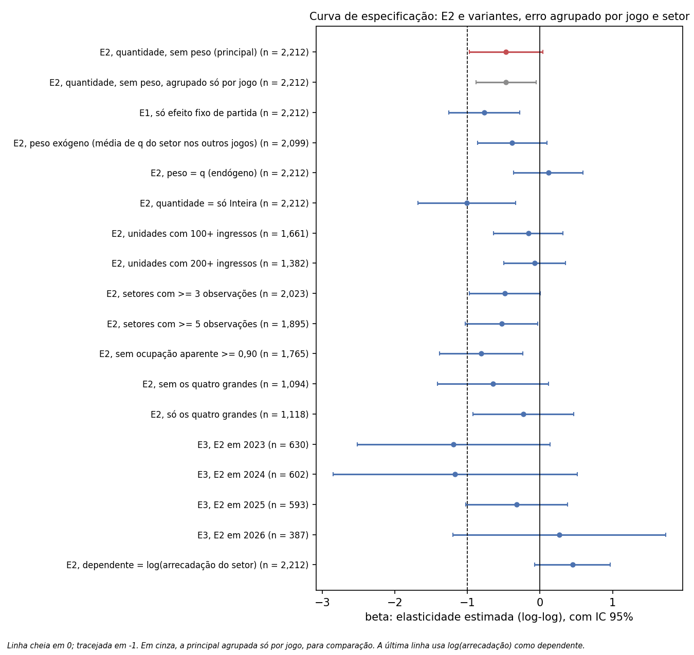
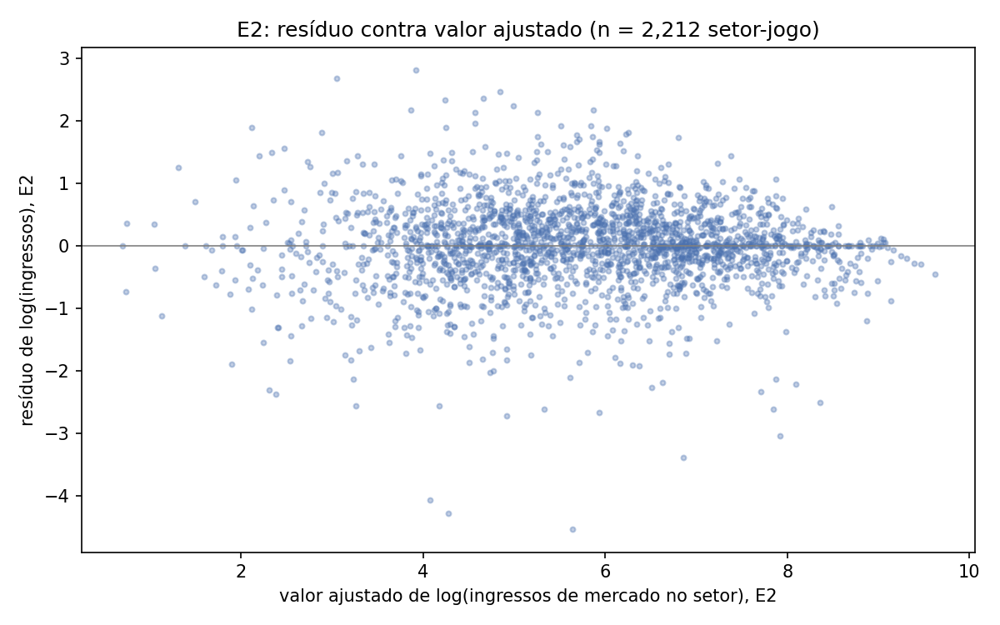
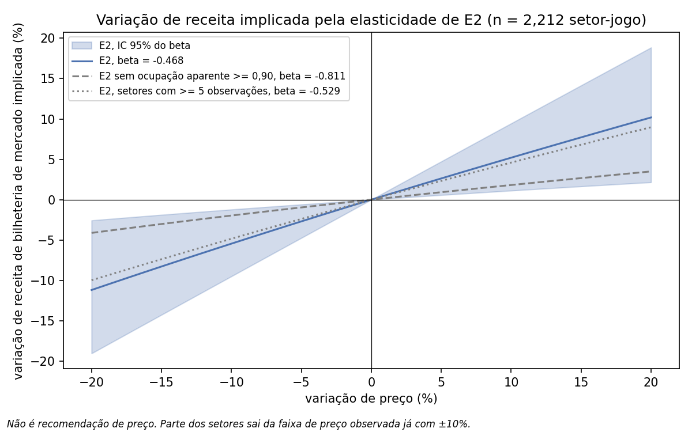

# Bilheteria do Paulistão: como o público responde ao preço do ingresso

Este projeto mede a elasticidade-preço da demanda por ingresso no
Paulistão Série A1, em 389 boletins financeiros oficiais de 2023 a 2026,
com efeito fixo de partida e de setor.

Quando um setor fica mais caro que os outros setores do mesmo jogo, o
ponto estimado indica queda de público, mas a base não distingue esse
efeito de zero. Na especificação principal, com erro agrupado por jogo e
por setor, a elasticidade estimada é -0,468, com intervalo de confiança de
95% de -0,975 a +0,039. O ponto é negativo em 14 de 16 variantes de
especificação. Nas 4 variantes cujo intervalo exclui zero, o intervalo
também passa de -1. A base não sustenta afirmar uma elasticidade
distinguível de zero, nem que a demanda é inelástica.

O número vale para preço relativo entre setores da mesma partida. Esta
base não mede o efeito de uma alta geral de preço, pelo motivo na
limitação 1.

## Problema

Os 20 maiores clubes brasileiros fecharam 2025 com receita somada de cerca
de R$ 15 bilhões e dívida somada de R$ 16 bilhões (levantamento Sports
Value de 2026 e levantamento financeiro anual da EY). A receita cresce e a
dívida cresce mais rápido.

Bilheteria é uma das poucas receitas que o clube controla por inteiro.
Direito de TV depende de contrato coletivo, patrocínio depende de mercado,
transferência depende de terceiros. O preço do ingresso é decisão interna,
tomada toda semana, em geral por intuição e costume.

A pergunta deste projeto é como a demanda por ingresso responde ao preço.

## Método

### Dados

O boletim financeiro de cada partida fica em URL determinística no site da
FPF. A coleta (`scripts/01_coleta_boletins.py`) baixou os 389 boletins das
temporadas 2023 (109 jogos), 2024 (104), 2025 (104) e 2026 (72). Os PDFs da
coleta ficam fora do repositório; quatro boletins ficam versionados em
`tests/fixtures/` para os testes (ver Fonte e direitos).

### Extração e validação

O parser (`scripts/02_parser_boletim.py`) lê o PDF por palavras com
coordenadas e atribui cada valor à coluna cujo cabeçalho está mais
próximo. O lote (`scripts/03_lote_boletins.py`) processou 388 boletins até
o fim e gravou 12.241 linhas em `data/03_processed/boletins.csv`. Um
boletim, 2025_57, ficou fora (ver Limitações).

Duas conferências rodam em todo boletim, e nenhuma falhou. O que elas
garantem é menos do que o nome sugere:

- **Linha contra TOTAIS.** A soma das linhas bate com a linha TOTAIS do
  boletim. Como linhas e TOTAIS são lidos pela mesma regra de proximidade
  de coluna, um deslocamento igual nos dois passaria. A conferência garante
  ausência de deslocamento assimétrico entre linhas e totais, não que a
  coluna esteja certa.
- **Vendidos x preço = arrecadação.** Só é informativa onde preço e
  quantidade são positivos e o preço é impresso: 11.484 das 12.241 linhas.
  Em 673 linhas (5,5%), todas de gratuidade, o preço é zero e a conta é
  0 = 0. Em 84 linhas de Fiel Torcedor o preço é derivado da própria
  arrecadação, e a tolerância aceita é o limite do arredondamento a
  centavos, então ali a conferência não pode falhar.
- **A venda - devolvidos = vendidos** é trivial na base: devolvidos é zero
  nas 12.241 linhas, e a venda é igual a vendidos em todas.

Há testes de regressão em `tests/`, incluindo um gabarito lido à mão do
boletim 2026_72 que cobre vendidos, a venda, devolvidos, preço e
arrecadação de cada linha, e testes de unidade da geometria do parser.

### Classificação

Cada rótulo de setor vira setor, subtipo e categoria, por dicionário
explícito em `referencias/`. Toda categoria recebe um regime: mercado,
sócio, contrato, gratuidade, não vendido ou promocional. Nome de clube e
de estádio também passam por dicionário. Nenhum rótulo, clube ou estádio
fica sem correspondência.

A tabela `referencias/razao_categoria_inteira.csv` mede a razão entre o
preço de cada categoria de mercado e a Inteira de mercado do mesmo setor e
jogo (do mesmo subtipo, ou sem subtipo quando não há), **antes** da guarda
que tira de mercado a Meia fora da metade. A coluna de situação diz onde a
linha terminou. A Inteira não entra na tabela: é a referência, e
compará-la consigo mesma daria 1 por construção.

| Categoria | Situação final | Observações | % exatamente metade | Razão mediana sobre a Inteira | Mínima | Máxima |
|---|---|---|---|---|---|---|
| Meia | mercado | 2.140 | 99,9 | 0,500 | 0,333 | 0,500 |
| Meia | contrato (subtipo Cativa) | 20 | 15,0 | 0,250 | 0,226 | 0,500 |
| Meia | revisão | 6 | 0,0 | 0,437 | 0,224 | 0,841 |
| Meia Promocional | mercado | 54 | 100,0 | 0,500 | 0,500 | 0,500 |
| PCR | mercado | 31 | 96,8 | 0,500 | 0,500 | 1,000 |
| Acompanhante | mercado | 16 | 0,0 | 1,000 | 1,000 | 1,000 |
| Meia Social | mercado | 10 | 0,0 | 0,550 | 0,246 | 0,563 |
| Solidário | mercado | 10 | 0,0 | 0,551 | 0,551 | 0,551 |
| Meia Solidária | mercado | 3 | 0,0 | 0,555 | 0,551 | 0,828 |
| Menor | mercado | 2 | 50,0 | 0,750 | 0,500 | 1,000 |
| Meia legal | mercado | 1 | 100,0 | 0,500 | 0,500 | 0,500 |
| Meia legal | gratuidade | 1 | 0,0 | 0,000 | 0,000 | 0,000 |

Antes da guarda, 2.166 Meias têm Inteira de referência. 2.140 (98,8%)
custam exatamente metade, com tolerância de R$ 0,01. As 26 restantes vão
de 0,224 a 0,841 da Inteira:

- 17 são Meia de cadeira cativa, que o subtipo já põe no regime contrato;
- 6 saem de mercado pela guarda e ficam em revisão (`revisao_meia`), com
  2.693 ingressos, entre elas a Meia patrocinada de 2024_44 a R$ 20 sobre
  Inteira de R$ 30 e quatro Meias escalonadas de 2024_40;
- 3 são P.C.D. - Meia do Palmeiras, que ficam em mercado como preço de
  acessibilidade.

Das Meias que ficaram em mercado, 2.137 de 2.140 são exatamente metade; as
3 restantes são as de P.C.D. O 99,9% da tabela, portanto, é em parte
consequência da guarda, e a dispersão real antes dela é a dos 2.166.

As outras categorias de mercado também são a Inteira vezes uma constante
(1,00 para Acompanhante, 0,50 para Meia Promocional e PCR), ou a Meia
acrescida de 10% de taxa de conveniência (Meia Social e Solidário, cerca
de 0,55 da Inteira e de 1,10 da Meia). As exceções: 4 linhas de Meia
Social num setor de preço escalonado de 2024_40, uma de PCR igual à
Inteira, uma de Meia Solidária a 0,83 e uma de Menor igual à Inteira
(2023_2). Com isso, a decisão de preço do clube em cada setor é
unidimensional: o preço da Inteira. As demais categorias seguem a Inteira
por lei ou por regra fixa e são marcadas como `preco_regulado`.

### Unidade e modelo

A unidade de análise é setor x jogo. O preço é o da Inteira do setor
(regime mercado, preço não regulado). A quantidade é a soma de todos os
ingressos de regime mercado vendidos no setor, inclusive Meia, porque quem
escolhe o setor pelo preço da Inteira pode comprar a Meia. Setor é
identificado por mandante e nome do setor.

A especificação principal (E2) é

log(ingressos) = beta x log(preço) + efeito fixo de partida + efeito fixo de setor

com quantidade sem ponderação e erro padrão agrupado em duas dimensões, jogo
e setor. O agrupamento duplo é necessário porque a mesma observação
pertence às duas dimensões: são 337 setores acompanhados ao longo de quatro
temporadas, e há dependência serial dentro do setor. Agrupar só por jogo
ignora essa dependência e subestima o erro. A versão original deste
projeto agrupava só por jogo; ela aparece no resultado, para comparação.

O efeito fixo de partida absorve tudo o que é comum ao jogo: adversário, data, estádio, momento do campeonato,
nível geral de preço. O efeito fixo de setor absorve o que é permanente no
setor: localização, conforto, tamanho. Sobra para identificar o beta a
variação do preço de um setor em relação aos outros setores do mesmo jogo,
de um jogo para outro.

Antes de qualquer resultado foram declaradas três especificações: E1, só
com efeito fixo de partida; E2, a principal; E3, E2 em cada temporada. As
três estão no resultado, junto com as variantes de ponderação, definição de
quantidade e amostra da curva de especificação
(`referencias/curva_especificacao.csv`), todas com agrupamento duplo. A estimação usa `linearmodels.PanelOLS`, e o beta
de E2 foi conferido contra uma implementação própria (centralização
alternada seguida de OLS): os dois coincidem até a precisão de máquina
(diferença de 3,3 x 10^-16).

Notebooks: `04_descritiva`, `05_modelo` e `06_receita`, em `notebooks/`.

## Resultado

### Curva de especificação



| Variante | beta | IC 95% | Obs. | Jogos | Setores |
|---|---|---|---|---|---|
| **E2, quantidade, sem peso (principal)** | **-0,468** | **[-0,975; +0,039]** | 2.212 | 387 | 337 |
| E2, principal agrupada só por jogo (comparação) | -0,468 | [-0,883; -0,053] | 2.212 | 387 | 337 |
| E1, só efeito fixo de partida | -0,769 | [-1,259; -0,279] | 2.212 | 387 | 337 |
| E2, peso exógeno (média de q do setor nos outros jogos) | -0,383 | [-0,858; +0,092] | 2.099 | 377 | 224 |
| E2, peso = q (endógeno) | +0,114 | [-0,365; +0,594] | 2.212 | 387 | 337 |
| E2, quantidade = só Inteira | -1,011 | [-1,683; -0,339] | 2.212 | 387 | 337 |
| E2, unidades com 100+ ingressos | -0,161 | [-0,637; +0,315] | 1.661 | 373 | 306 |
| E2, unidades com 200+ ingressos | -0,075 | [-0,502; +0,352] | 1.382 | 354 | 283 |
| E2, setores com >= 3 observações | -0,485 | [-0,976; +0,006] | 2.023 | 369 | 186 |
| E2, setores com >= 5 observações | -0,529 | [-1,027; -0,030] | 1.895 | 349 | 150 |
| E2, sem ocupação aparente >= 0,90 | -0,811 | [-1,387; -0,236] | 1.765 | 364 | 215 |
| E2, sem São Paulo, Palmeiras, Santos e Corinthians | -0,647 | [-1,413; +0,119] | 1.094 | 277 | 182 |
| E2, só esses quatro | -0,231 | [-0,924; +0,463] | 1.118 | 110 | 155 |
| E3, E2 em 2023 | -1,191 | [-2,518; +0,136] | 630 | 109 | 179 |
| E3, E2 em 2024 | -1,170 | [-2,853; +0,513] | 602 | 104 | 169 |
| E3, E2 em 2025 | -0,321 | [-1,020; +0,379] | 593 | 103 | 131 |
| E3, E2 em 2026 | +0,267 | [-1,199; +1,732] | 387 | 71 | 129 |

Todas as linhas, menos a de comparação, usam erro agrupado por jogo e
setor.

**Leitura.** O ponto estimado é negativo em 14 das 16 variantes e, na
principal e nas variantes de ponderação exógena e de amostra por número de
observações, fica entre -0,38 e -0,53. Mas com agrupamento duplo a
principal não exclui zero: o intervalo vai de -0,975 a +0,039. Agrupada só
por jogo, como na versão original, ela excluía zero por pouco
([-0,883; -0,053]); a diferença é só o erro.

Quatro variantes excluem zero: E1, quantidade só Inteira, setores com 5 ou
mais observações e o filtro de ocupação aparente. Nas quatro, o intervalo
também passa de -1, então nenhuma delas sustenta inelasticidade. A de
quantidade só Inteira dá -1,011, perto de elasticidade unitária, o que
inverte a conclusão de inelasticidade. A base não sustenta afirmar uma
elasticidade distinguível de zero na especificação principal, nem que a
demanda é inelástica.

**Ponderação endógena.** Ponderar log(q) por q é ponderar pela própria
variável dependente, e isso enviesa. Com peso q o ponto vira +0,114
([-0,365; +0,594]). Com peso exógeno, a média de q do mesmo setor nos
outros jogos, o sinal não inverte: fica em -0,383 ([-0,858; +0,092]). A
inversão para +0,114 é em boa parte artefato do peso. O mesmo vale para os
cortes por tamanho (100+ e 200+ ingressos), que selecionam pela dependente
e puxam o ponto para -0,161 e -0,075.

**Por temporada**, o resultado não se distingue de ruído: nenhum dos
quatro intervalos exclui zero, e 2026 tem sinal positivo.

Placebo do filtro de censura: com o preço embaralhado dentro de cada jogo,
60 vezes (semente 20261013), o beta médio fica em -0,001 sem o filtro de
ocupação (desvio-padrão de 0,055 entre as repetições) e em +0,001 com ele
(desvio-padrão de 0,051). O filtro desloca o beta médio em +0,002, muito
menos que a dispersão de uma repetição para outra. O filtro, sozinho, não
produz o resultado. Esse desvio-padrão não é medida de incerteza
alternativa: o embaralhamento destrói a dependência dentro do jogo que o
erro agrupado contabiliza.



### O que isso implica

A pergunta que a base responde é estreita: o que acontece com a
arrecadação de mercado de **um** setor quando o preço da Inteira **desse**
setor sobe em relação aos outros setores do mesmo jogo. Com o coeficiente
direto de log(arrecadação do setor) em E2, com erro agrupado por jogo e
setor, uma alta relativa de 10% corresponde a +4,36% na arrecadação de
mercado do setor, com faixa de -0,69% a +9,67% pelo IC 95%. A faixa
contém zero.

O número não pode ser somado sobre os setores do jogo nem multiplicado por
uma receita agregada. Se todos os setores sobem 10%, nenhum subiu em
relação aos outros, e esse movimento é exatamente o que o efeito fixo de
partida absorve.

O coeficiente de receita é estimado diretamente, e não como 1 + beta,
porque o preço do modelo é o da Inteira e a quantidade soma Meia. O
repasse da Inteira para o preço médio realizado do setor é 0,916, não 1, e
a identidade fecha: -0,468 + 0,916 = +0,448, o coeficiente de
log(arrecadação).



A evidência para aí. Ela não diz o que acontece numa alta geral de preço,
não diz qual é o preço ótimo e não diz que algum clube cobra pouco (ver
Limitações 1, 2, 9 e 11).

## Limitações metodológicas conhecidas

**1. O beta é de setor, com substituição, não de mercado.** O efeito fixo
de partida absorve todo movimento de preço comum aos setores do jogo, então
o beta de -0,468 é identificado só pelo preço de um setor relativo aos
outros do mesmo jogo. Parte da queda de público quando um setor encarece
são pessoas que trocam de setor. Numa alta geral não há para onde trocar,
e a elasticidade de mercado é menor em módulo que -0,468. Esta base não
mede a elasticidade agregada e não tem como medir: exigiria variação de
preço entre partidas com demanda constante, que é justamente o problema de
endogeneidade que o efeito fixo resolve. O efeito fixo de partida reduz o
desvio-padrão de log(preço) de 0,663 para 0,359, e o de setor, para 0,101.
A estimativa vem dessa variação residual pequena.

**2. Fragilidade a escolhas de especificação.** A conclusão depende de
três escolhas que a versão original não discutia. Nível de agrupamento do
erro: a principal, -0,468, exclui zero agrupada só por jogo
([-0,883; -0,053]) e não exclui com agrupamento por jogo e setor
([-0,975; +0,039]). Ponderação: com peso q o ponto vira +0,114
([-0,365; +0,594]), com peso exógeno fica em -0,383 ([-0,858; +0,092]).
Definição de quantidade: com só ingressos Inteira, -1,011
([-1,683; -0,339]). Cortes por tamanho, que selecionam pela dependente,
levam o ponto a -0,161 (100+ ingressos) e -0,075 (200+). Das 16 variantes
com agrupamento duplo, 4 excluem zero, e nas 4 o intervalo também passa de
-1. A curva completa está em `referencias/curva_especificacao.csv`.

**3. Endogeneidade residual.** O clube também escolhe o preço de cada
setor. Se ele encarece o setor que espera vender bem naquele jogo, por
motivo que nem o efeito fixo de partida nem o de setor captura, o beta é
puxado em direção a zero. A base não tem instrumento para separar isso.
Sem modelo, preço e público andam juntos entre setores e jogos
(`figuras/04_descritiva/d_preco_publico_setor.png`), porque clube caro é
clube grande. Os efeitos fixos removem essa parte, não a escolha de preço
dentro do jogo.

**4. Censura por capacidade.** Sem laudo técnico de capacidade dos
estádios, não se sabe que setor esgotou. Em setor esgotado, o público
observado é teto, não demanda, e isso puxa o beta para zero. O filtro usado
é proxy: ocupação aparente é o público do setor no jogo dividido pelo maior
público do mesmo setor na base. Excluir as 447 unidades com ocupação
aparente de 0,90 ou mais leva o beta de -0,468 a -0,811. O máximo
histórico subestima a capacidade, então o filtro é conservador e não
resolve a censura.

**5. Parte pequena da base identifica o modelo.** O subconjunto
identificador (regime mercado, preço não regulado) são 2.290 das 12.241
linhas. O regime mercado é 43,4% dos ingressos da base (2.094.600 de
4.821.229). Sócio é 41,8%, contrato 11,0%, gratuidade 2,0%, não vendido
1,7% e promocional 0,1%. A elasticidade vale para o público de mercado,
não para o sócio-torcedor nem para o contrato de longo prazo.

**6. Concentração.** São Paulo, Palmeiras, Santos e Corinthians somam
50,5% das unidades da estimação (1.118 de 2.212 setor-jogos) e 58,0% dos
ingressos de mercado dessas unidades, em 110 dos 387 jogos. Com erro
agrupado por jogo e setor, sem eles o beta é -0,647, com IC 95% de -1,413 a
+0,119 (1.094 setor-jogos, 277 jogos, 182 setores). Só com eles, o beta é
-0,231, com IC 95% de -0,924 a +0,463 (1.118 setor-jogos, 110 jogos, 155
setores). Os dois intervalos contêm zero e se sobrepõem, então não dá para
afirmar que os grupos diferem nem que algum deles tem elasticidade
distinguível de zero. O ponto mais negativo sem os quatro grandes indica
que o resultado não é puxado por eles.
*Hipótese, não testada:* clube grande esgota setor com mais frequência, e
a censura puxa o beta para zero (Limitação 4), o que explicaria um beta
menor em módulo entre os quatro grandes.

**7. Anomalia de composição em 2025.** O público de mercado por jogo cai
de 6.043 em 2024 para 3.928 em 2025 e volta a 5.402 em 2026. Ao ritmo de
2024, faltam 217.870 ingressos de mercado em 2025. A queda atinge 8 dos 14
mandantes presentes nas duas temporadas, com Santos a -77%, Mirassol a
-72%, Botafogo a -64%, São Paulo a -56% e Corinthians a -52%; seis
mandantes ficam estáveis ou sobem. Rótulos novos de sócio e contrato em
2025 somam 4.226 ingressos, e o boletim não ficou menos detalhado (31,0
linhas por boletim em 2024 e 33,3 em 2025). A causa é desconhecida e
nenhuma correção foi aplicada.

**8. Taxa de conveniência de 10%.** Em parte dos boletins ela aparece como
categoria própria (Meia Social, Solidário, a 1,10 da Meia). Em outros pode
estar embutida no preço da Inteira. Isso contamina a comparação de nível de
preço entre clubes (`notebooks/04_descritiva`, gráfico c).

**9. Faixa de preço observada.** A conta de receita só vale dentro da
faixa de preço que cada setor já praticou. Com +20% de preço, 30,0% dos
setor-jogos saem da faixa do próprio setor; com -20%, 51,3%; com +10%,
26,3%; com -10%, 42,8%. 142 dos 337 setores praticaram um só preço real em
toda a base, e para eles qualquer variação é extrapolação.

**10. Dados ausentes e inconsistentes na fonte.** O boletim 2025_57 está
fora da base: o cabeçalho da tabela sai embaralhado na extração e a linha
TOTAIS não traz arrecadação, então o jogo não pode ser validado. Os números
não foram digitados à mão. Em 2024_40 (Inter Limeira x São Paulo), 7 linhas
rotuladas Gratuidade têm preço de R$ 89 a R$ 219 e somam R$ 212.586. O
rótulo e o preço se contradizem na fonte, e as linhas ficam em revisão,
fora de qualquer regime.

**11. Recomendar preço não é entrega deste projeto.** Com coeficiente de
arrecadação positivo e constante, a receita do setor cresce sem limite com
o preço no modelo. Isso é consequência da forma funcional, não do mundo, e
por isso não há preço ótimo a calcular. Além disso, o intervalo do
coeficiente contém zero, e nem o sinal do efeito sobre a receita está
estabelecido. A conta de receita também
ignora o que o preço afeta além da bilheteria: consumo dentro do estádio,
conversão de sócio, formação de torcedor no longo prazo, ambiente de
estádio cheio e capacidade. O clube pode estar escolhendo o preço atual de
propósito, por esses motivos.

## Estrutura do repositório

| Caminho | Conteúdo |
|---|---|
| `scripts/01_coleta_boletins.py` | Download dos boletins |
| `scripts/02_parser_boletim.py` | Parser de um boletim |
| `scripts/03_lote_boletins.py` | Lote dos 389 boletins e padronização |
| `referencias/` | Dicionários de categoria, subtipo, clube e estádio; IPCA; razão sobre a Inteira; curva de especificação |
| `data/03_processed/` | Base processada e dicionário de colunas |
| `notebooks/` | Descritiva (04), modelo (05) e receita (06) |
| `figuras/` | Gráficos gerados pelos notebooks |
| `tests/` | Testes de regressão do parser e do lote |
| `requirements.txt` | Pacotes e versões usados |
| `LICENSE` | Licença MIT do código |

## Fonte e direitos

Os boletins são da Federação Paulista de Futebol, baixados da URL
determinística
`https://conteudo.fpf.org.br/Competicoes/{ANO}/3973/boletins-financeiros/{N}/boletins/{N}.pdf`,
em que 3973 é o identificador do Paulistão A1 e N é o número do jogo. A
coleta foi feita em 10/10/2026.

A FPF não concedeu licença para este uso, e os termos de uso do site não
foram verificados.

O código deste repositório é licenciado sob MIT (`LICENSE`). A contribuição
do autor sobre os dados derivados (a base processada em
`data/03_processed/`, os dicionários e tabelas em `referencias/`, os
gráficos e o texto) é licenciada sob CC BY 4.0. Nenhuma das duas licenças
cobre o conteúdo original dos boletins da FPF, cujos direitos continuam da
FPF.

`tests/fixtures/` contém quatro boletins oficiais completos (2023_55,
2024_52, 2025_78 e 2026_72), um por temporada. Eles ficam versionados
porque os testes de regressão precisam de PDFs reais: cobrem a tabela em
várias páginas, linhas vazias do formulário, categorias como PCR e Cativa
e o gabarito lido à mão de 2026_72. Os demais PDFs da coleta não estão no
repositório.

## Como reproduzir

Python 3.12.7. Instale as dependências:

```
python -m pip install -r requirements.txt
```

Na raiz do repositório, rode na ordem:

```
python scripts/01_coleta_boletins.py
python scripts/03_lote_boletins.py
python -m unittest discover tests
```

1. `01_coleta_boletins.py` baixa os 389 boletins da FPF para
   `data/01_raw/{ano}/`. Precisa de rede. Os PDFs não estão no repositório.
   A coleta espera 1 segundo entre requisições (opção `--intervalo`), pula
   o que já está em disco e registra falhas sem interromper.
2. `03_lote_boletins.py` roda o parser em todos os boletins, grava
   `data/03_processed/boletins.csv` e `referencias/razao_categoria_inteira.csv`
   e imprime o relatório do lote. Os dois arquivos só são substituídos se
   nenhum boletim fora da lacuna conhecida (2025_57) abortar; sem os PDFs em
   disco, ou com a coleta incompleta, o lote não toca nos arquivos
   versionados e termina com código de saída 1.
3. Os testes conferem o gabarito de 2026_72, os fixtures em
   `tests/fixtures/` e a padronização do CSV.
4. Depois, abra e execute os notebooks em ordem, num ambiente Jupyter:
   `notebooks/04_descritiva.ipynb`, `05_modelo.ipynb` e `06_receita.ipynb`.
   Os gráficos são gravados em `figuras/`. O Jupyter não está em
   `requirements.txt`, que lista só os pacotes que o código importa.

`scripts/02_parser_boletim.py` também roda sozinho sobre um boletim, para
inspeção: `python scripts/02_parser_boletim.py data/01_raw/2026/2026_72.pdf`.
